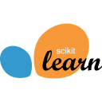

# Hi, I'm Subhrajit 👋

I'm an undergraduate researcher in NLP at **Sister Nivedita University, Kolkata** (BCA Honors with Research). I work on how large language models represent culture, with a focus on Indic languages and Indian cultural and literary heritage.

🌐 **[subhrajitmkj04.github.io](https://subhrajitmkj04.github.io)**: my personal site. Read the [résumé](https://subhrajitmkj04.github.io/#hire), or [play through my journey](https://subhrajitmkj04.github.io/#play) in one of five mini-games.

## 🔬 Research interests

- **Cultural knowledge and bias in LLMs**: how models represent, flatten or stereotype culture, especially Indian regional culture
- **Mechanistic interpretability**: probing what models know internally versus what they say
- **Low-resource Indic NLP**: Indic languages, code-mixed text, cross-cultural settings
- **Computational humanities**: NLP and knowledge graphs for heritage texts such as the Mahabharata
- **Multimodal reasoning**: turning metaphorical text into coherent visual storytelling

## 🏛️ Where I do research

| Role | Where | Since |
|---|---|---|
| Student Researcher | Aethersaga Lab, Sister Nivedita University | Feb 2026 |
| Research Intern | Jadavpur University, under Dr. Dipankar Das | May 2026 |
| Research Intern | Dhrisha Lab, IIT Patna, under Dr. Sriparna Saha | Aug 2026 |

## 📄 Publications

**The Mirage of Diversity: Unmasking the Cultural Vocabulary Ceiling in LLMs**
C3NLP Workshop, ACL 2026 · [ACL Anthology](https://aclanthology.org/2026.c3nlp-1.7/)
Shows that LLMs asked to adapt stories to a culture fail to scale cultural vocabulary with text length, and introduces CSAI, a metric that penalizes stereotype-heavy, incoherent keyword insertion. Across three models, CSAI is only 0.09–0.19 of the human baseline.

**Named Entity Recognition in the Mahabharata using LLM-Generated Silver Annotations**
IEEE PuneCon 2026 (accepted)
Adapts a lightweight spaCy NER model to the Mahabharata using only LLM-generated silver annotations: 81.1 micro span-F1 on human-corrected gold data, versus 32.7 for the pretrained baseline.

## 🛠️ Projects

- **Mahabharata Interpretable NER**: interpretable NER for mythological entities in the Mahabharata corpus (Python, spaCy)
- **Comparative Study of Lexical Algorithms with Visualizations**: One-Hot, Bag-of-Words and TF-IDF pipelines benchmarked on 20 Newsgroups; TF-IDF reached 96.5% accuracy (Python, Scikit-learn, NLTK)
- **Customer Churn Predictor with Explainability**: end-to-end churn pipeline on the IBM Telco dataset with SHAP explanations (Python, Scikit-learn, XGBoost)

## 💻 Tech stack

**Languages**

<table>
  <tr>
    <td align="center" width="110"> Python</td>
    <td align="center" width="110"> Java</td>
    <td align="center" width="110"> C</td>
    <td align="center" width="110"> SQL</td>
  </tr>
</table>

**ML / NLP**

<table>
  <tr>
    <td align="center" width="110"> PyTorch</td>
    <td align="center" width="110"> TensorFlow</td>
    <td align="center" width="110"> HuggingFace</td>
    <td align="center" width="110"> Scikit-learn</td>
    <td align="center" width="110"> spaCy</td>
    <td align="center" width="110"> NLTK</td>
    <td align="center" width="110"> Unsloth</td>
  </tr>
</table>

**Data & Visualization**

<table>
  <tr>
    <td align="center" width="110"> NumPy</td>
    <td align="center" width="110"> Pandas</td>
    <td align="center" width="110"> Matplotlib</td>
    <td align="center" width="110"> Seaborn</td>
    <td align="center" width="110"> Power BI</td>
  </tr>
</table>

**Web & Backend**

<table>
  <tr>
    <td align="center" width="110"> HTML5</td>
    <td align="center" width="110"> CSS3</td>
    <td align="center" width="110"> JavaScript (ES6+)</td>
    <td align="center" width="110"> React</td>
    <td align="center" width="110"> Supabase</td>
    <td align="center" width="110"> Firebase</td>
  </tr>
</table>

**Tools:** Git/GitHub, LaTeX

## 🤝 Open to

Research collaborations in cultural NLP, Indic and low-resource languages, and interpretability. Feel free to reach out by email.
